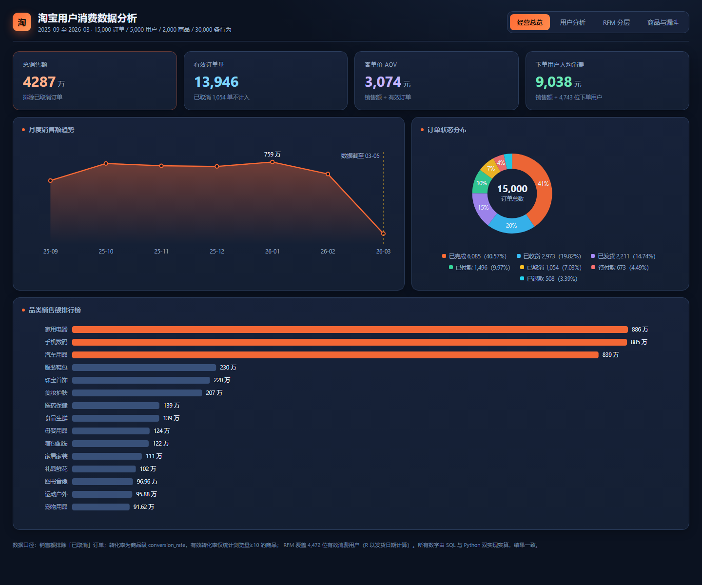
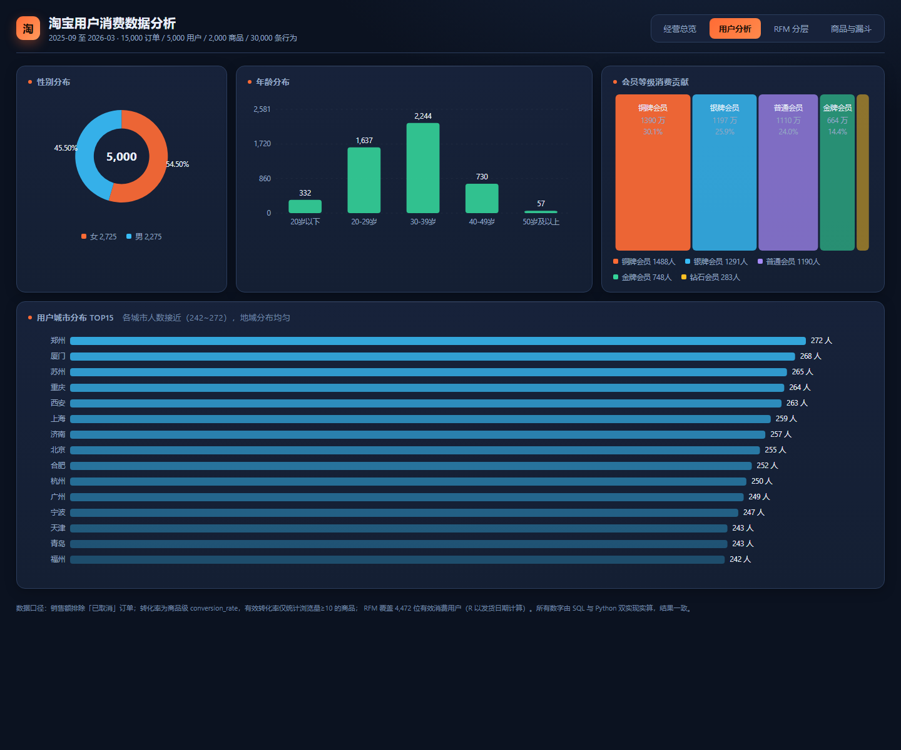
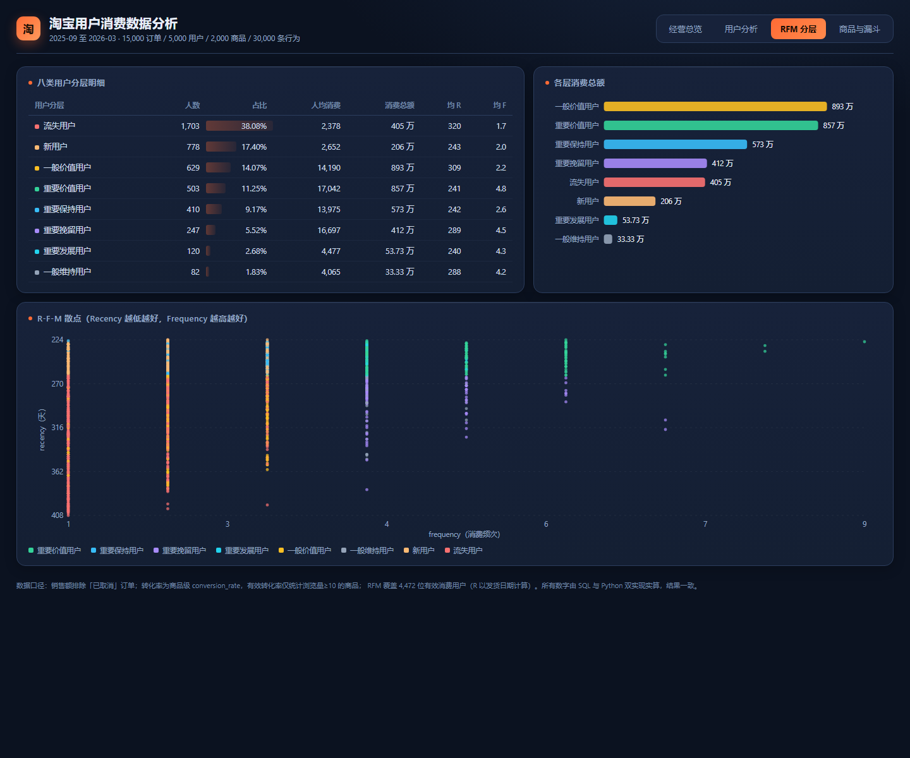
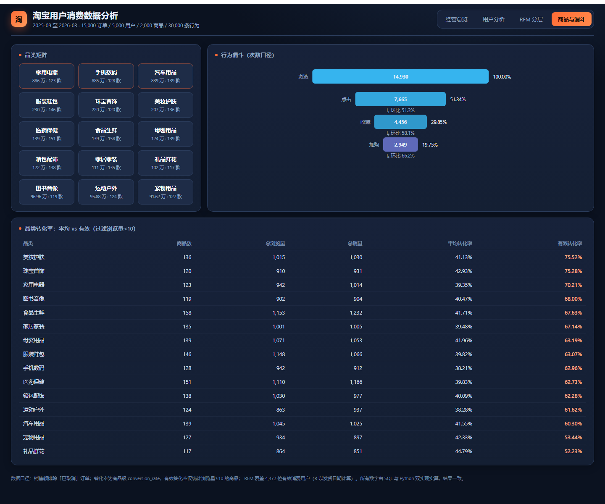

# 淘宝用户消费数据分析与经营看板

<p>
  
  
  
  
</p>

一套从原始数据到经营看板的完整电商消费分析：**六张源表 → 数据质量体检 → 星型模型 → 用户画像 / RFM / 商品 / 漏斗 → 四页 Power BI 看板**。

同一套分析用 **MySQL 与 Python 两条独立链路**实现并交叉对账，6 组核心指标零差异。



---

## 分析得到了什么

四条判断，每条都对应一个可执行的动作：

| 判断 | 依据 | 因此改变的动作 |
| --- | --- | --- |
| **评分字段不可用** | 未评分订单占 **71.85%**（10,777 / 15,000） | 放弃评分口径，满意度改用浏览 / 点击 / 收藏 / 加购行为替代 |
| **会员等级不能当价值依据** | 金牌 + 钻石会员占 **20.6%** 人数，只贡献 **19.9%** 消费；五档人均全落在 8,877–9,344（差 < 5%） | 分层改用 RFM 行为维度，资源投给行为价值最高的 11.25% 人群（贡献 25% 消费） |
| **营收呈哑铃结构** | **7.55%** 的高价订单贡献 **36.03%** 销售额；72.2% 的订单挤在千元以下只贡献 29.31%；2000–2999 元档仅 333 单 | 判定该档为供给空档而非需求不足，输出补位选品建议 |
| **流失集中在浏览到点击** | 四阶段 14,930 → 7,665 → 4,456 → 2,949，浏览到点击一次性流失 **48.66%**（7,265 条），为绝对流失最大环节 | 优化位前置到浏览层的选品与主图匹配，而非后段转化 |

### 关键指标

| 指标 | 值 |
| --- | ---: |
| 有效 GMV | 42,868,816.33 |
| 有效订单数 | 13,946 |
| 客单价 | 3,073.91 |
| 有效下单用户数 | 4,693 |
| 人均消费 | 9,134.63 |
| RFM 有效用户 / 分层 | 4,472 / 8 类 |
| 漏斗（浏览→加购） | 14,930 / 7,665 / 4,456 / 2,949 |

> 计算口径见 [`docs/项目总结.md`](docs/项目总结.md) 与 [`docs/复现核对.md`](docs/复现核对.md)。所有数字均可在 [`outputs/`](outputs) 中查到对应结果表。

---

## 看板

四个页面，均为 Power BI 深色主题（设计规格与配色见 [`bi/`](bi)）：

| 经营总览 | 用户分析 |
| --- | --- |
|  |  |

| RFM 分层 | 商品与漏斗 |
| --- | --- |
|  |  |

不想装 Power BI 也能看效果：[`bi/dashboard.html`](bi/dashboard.html) —— 单文件离线看板，用同一份数据、同样的图与配色重新实现，双击即开。

---

## 目录结构

```
taobao_sales_analysis/
├── data/                     六张源表（CSV，约 5 MB）
├── sql/                      00~07 共 8 个可复跑脚本（建库导入 → 质检 → 清洗 → 建模 → 四类分析）
├── src/                      Python 实现（与 SQL 逐模块对应）
│   ├── config.py             口径常量：订单状态分组、字段映射、阈值
│   ├── data_loader.py
│   ├── q1_data_quality.py    ~ q7_behavior_funnel.py
│   └── main.py               串联 Q1~Q7，输出 28 张结果表
├── outputs/                  28 张结果表（CSV）
├── bi/
│   ├── dashboard.html        单文件离线看板
│   ├── PowerBI复现指南.md      从零搭建的完整步骤（连接串、DAX、排查）
│   ├── 美化与收尾.md           深色主题、格式修正、提亮效果
│   ├── 字段中文名对照表.md      六张表全字段中英对照
│   ├── taobao-midnight.json  Power BI 主题文件
│   └── p1~p4.png             四页截图
└── docs/
    ├── 项目总结.md            八环节流程 + 各板块结论 + 口径说明
    └── 复现核对.md            实跑结果与原文档的口径差异清单（15 项）
```

---

## 快速开始

### 方式一：Python

```bash
pip install -r requirements.txt
python src/main.py
```

结果写入 `outputs/`。数据放在 `data/` 下，无需额外配置。

### 方式二：MySQL

```bash
mysql -u root -p < sql/00_create_and_load.sql
mysql -u root -p taobao_sales < sql/01_data_quality.sql
# 依次执行 02 ~ 07
```

`00_create_and_load.sql` 使用 `LOAD DATA LOCAL INFILE` 导入 CSV，需要在客户端与服务端都开启 `local_infile`。字段映射、精度（`DECIMAL(16,2)` / `DECIMAL(3,2)`）、换行符（CRLF）均已在脚本内处理。

### 方式三：Power BI

见 [`bi/PowerBI复现指南.md`](bi/PowerBI复现指南.md)，含 ODBC 连接串、日期表与星型关系、全部 DAX 度量、以及踩过的坑（日期键与时间戳不匹配、状态口径分层、散点图聚合方式等）。

---

## 数据模型

星型模型，两张维度表 + 两张事实表 + 一张日期表：

| 表 | 行数 | 角色 |
| --- | ---: | --- |
| `dim_user` | 5,000 | 维度表（19 列：属性 + 消费特征） |
| `dim_product` | 2,000 | 维度表（17 列：属性 + 经营特征） |
| `fact_orders` | 15,000 | 事实表 |
| `fact_behaviors` | 30,000 | 事实表 |
| `日期表` | 212 | 2025-09-01 ~ 2026-03-31 |

关系：`fact_orders` / `fact_behaviors` 分别以 `user_id`、`product_id` 多对一接入两张维度表，单向筛选。

> 数据时间范围：2025-09-06 至 2026-03-05。**2026-03 仅含 5 天数据（375 单，占全量 2.7%）**，趋势图末尾的下跌是数据边界，不是业绩下滑。

---

## 方法论上的几点说明

- **口径分层**：7 种订单状态按用途拆为四套口径——全量（订单状态结构）、有效（GMV / 订单数，排除已取消）、漏斗（四阶段行为）、RFM（仅纳入发货记录非空的用户）。一套状态口径打天下会算错，尤其人均消费这类分子分母口径必须一致。
- **双实现对账**：MySQL 与 Python 各自独立实现，RFM 有效人数、四阶段漏斗行为数、GMV、订单数、客单价、缺失分级计数共 6 组指标逐项比对，零差异。
- **数据局限**：本数据集的浏览用户与下单用户重合度达 93.8%，加购行为数（2,949）小于有效订单数（13,946），说明它不是一条真实的下单路径。因此漏斗只能用于**横向比较不同品类**，不能当作绝对购买转化率对外汇报。

---

## 后续更新

Power BI 报表文件（`.pbix`）做好后如何补进仓库，见 [`CONTRIBUTING.md`](CONTRIBUTING.md)。
